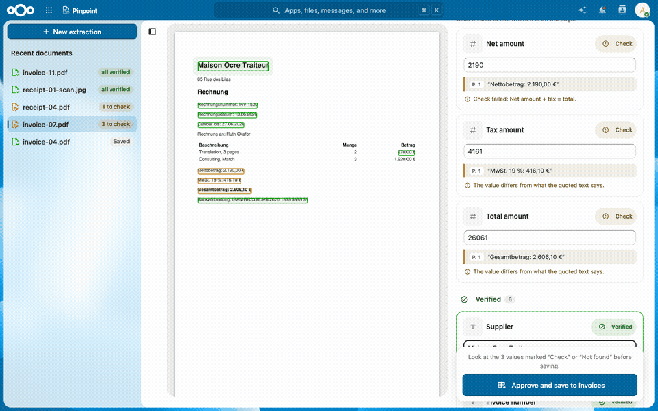
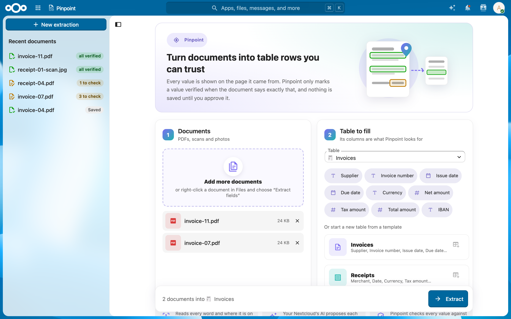
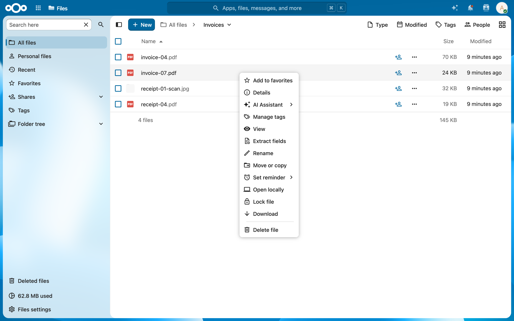
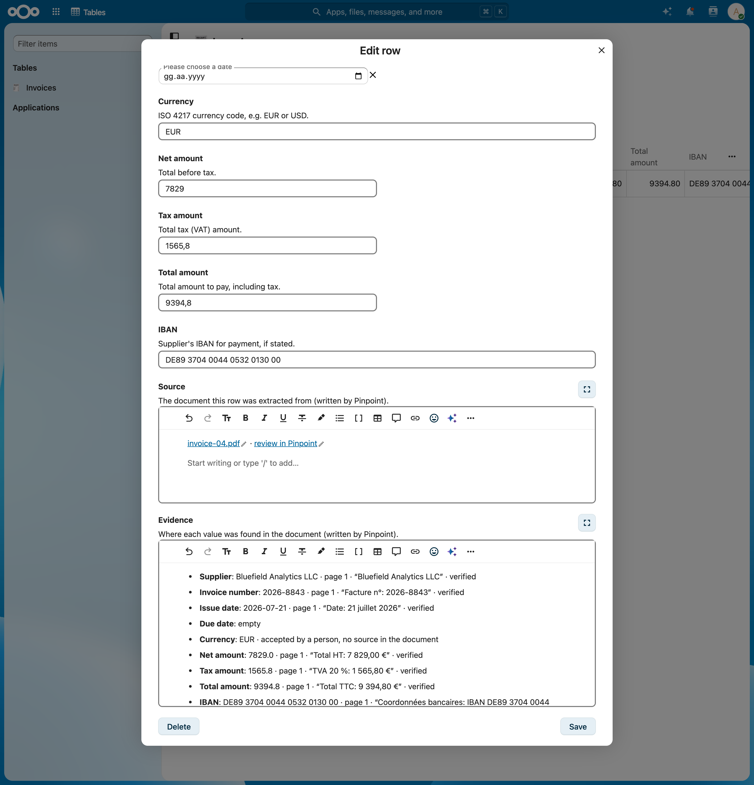

# Pinpoint

Pinpoint is a Nextcloud app that reads invoices, receipts and other documents in your Files and fills a row
in [Tables](https://apps.nextcloud.com/apps/tables) for each one. For every value it shows where it was found:
the page, the highlighted spot and the exact text. Values the document doesn't back up are flagged for a
person to check instead of being saved as fact.



## Why

Language models read documents well, and when they're wrong they're wrong confidently. While building this,
a 7B model running locally read "MwSt. 19 %: 416,10 €" on a German invoice and answered 4161. Nothing about
the answer looked off. It was a well-formed number in a well-formed JSON object.

Pinpoint doesn't trust the answer, it checks it. The model has to quote the text it read each value from.
Pinpoint looks that quote up in the document's own text and only marks a value **verified** when the document
literally says it. In the case above the quote was found, but "416,10" isn't 4161, so the value went to review.
Net + tax didn't add up to the total either, and that check failed too.

## How it works

1. **Text with positions.** A PDF's own text layer is read with PyMuPDF. Scans and photos go through Tesseract
   inside the app's container. Nextcloud's OCR task type returns plain text without positions, and Pinpoint
   needs to know where every word is.
2. **The model.** Pinpoint has no model of its own. It sends the text and the list of fields to Nextcloud's
   TaskProcessing API, so it runs on whatever text generation provider the admin configured: the local
   [llm2](https://apps.nextcloud.com/apps/llm2), LocalAI, Ollama, OpenAI. For each field the model returns a
   value, the exact text it read it from and the page.
3. **Anchoring.** The quote is looked up in the document's words: exactly first, then ignoring spaces (OCR
   splits numbers), then fuzzily for OCR noise, which never counts as verified. Highlight boxes always come from
   the document's word positions, never from the model.
4. **Verification.** The value has to agree with the text found at that spot. Numbers and dates are parsed the
   way the document writes them ("1.234,56", "14 mars 2026", "03/14/2026"). Text has to appear literally.
   Then the values are checked against each other: net + tax = total, the due date isn't before the issue date,
   required columns are filled.
5. **Review.** Nothing is saved until a person approves it. The row written to Tables keeps a link to the file
   and an Evidence cell with the page and quote for every value, so the provenance stays with the data.

| Status | Meaning |
|---|---|
| **Verified** | The document says exactly this, at the highlighted spot. |
| **Check** | Found in the document, but something needs a look: the value differs from the quoted text, the quote only matches approximately (OCR), a cross-check failed, the date could be day/month or month/day, or the value is the model's reading of the text (a "Card" option for "Kartenzahlung"). |
| **Not found** | The model gave a value but it isn't in the document. Treat it as a guess. |
| **Empty** | The model found no value for this field. |

## Using it

- **Your table is the schema.** Pick a table and its columns are what Pinpoint looks for. Column descriptions
  are passed to the model, so you steer extraction in Tables where you already work. Text, number, date,
  selection and yes/no columns are filled. To start, Pinpoint can create an Invoices or Receipts table for you.
- **From Files:** right-click a PDF or image, choose **Extract fields**.
- **From the Pinpoint page:** pick documents and a table. You get a notification when a document is ready.
- **From the Assistant:** Pinpoint adds an **Extract fields from a document** task. It returns the fields as
  JSON with their page, text and position, plus a readable evidence list. Anything that uses TaskProcessing,
  Context Agent or Flow for example, can call it too.

| Start an extraction | The Files action | The saved row, with its evidence |
|---|---|---|
|  |  |  |

## Evaluation

[`evals/`](evals/) has 30 synthetic invoices and receipts: four languages (English US/UK, German, French), four
number formats, five date formats, missing fields, and 6 scanned images that only OCR can read. They're
generated from a fixed seed with known ground truth. The generator checks that every ground-truth quote really
is in its PDF before writing it.

**The verification layer**, with the model replaced by the ground truth plus deliberate faults (invented
values, values that contradict their quote, one-digit near misses, quotes that aren't in the document, swapped
amounts). Every fault type has a positive control, so a checker that flags everything fails as surely as one
that flags nothing. CI fails below 97% on either number.

| | Result |
|---|---|
| Correct answers given the expected status (8,000+ field checks) | 100% |
| Wrong answers that were not marked verified | 100% |

The interesting part is what it caught while being built. An early version compared text values fuzzily, and
a test showed that "RE-67859" would pass as "RE-6785". Text now has to match literally, and the eval has a
"near miss" fault type (one character, one cent or one day off) so that class of bug stays caught.

**The whole pipeline with a real model** (`qwen2.5:7b` on Ollama, a laptop CPU/GPU): see
[evals/results/qwen2.5-7b.md](evals/results/qwen2.5-7b.md) for the per-field breakdown.

| | qwen2.5:7b |
|---|---|
| Field accuracy | 96.7% (232 of 240) |
| Values marked verified that were correct | 98.6% (210 of 213) |
| Wrong values marked verified | 3 of 8, all on scans |
| Median time per document | 17 s |

On the 24 digital PDFs no wrong value was marked verified. The three on scans are one OCR error: Tesseract
read the bold "Bürobedarf" and "Bäckerei" without the umlaut, at 90% confidence, and the model copied what the
OCR read. Verification is only as good as the text it checks against, so values verified on a scanned page now
say they were matched against OCR text. The other five wrong values were IBANs the model said weren't there,
which show up as Empty, not as verified.

The "416,10 € → 4161" example at the top came from a run through Nextcloud with the provider's default
settings. The eval run uses temperature 0 and didn't hit that error, which is a fair reminder that one run
of a small model isn't the next.

## Install

Requirements:
- Nextcloud 33 or newer, with [AppAPI](https://docs.nextcloud.com/server/latest/admin_manual/exapps_management/AppAPIAndExternalApps.html)
  and a deploy daemon (HaRP is the recommended one).
- The [Tables](https://apps.nextcloud.com/apps/tables) app.
- A text generation provider under *Administration → Artificial intelligence*, for example
  [llm2](https://apps.nextcloud.com/apps/llm2) (local) or the
  [OpenAI and LocalAI integration](https://apps.nextcloud.com/apps/integration_openai) pointed at OpenAI,
  LocalAI or Ollama.

**From the App Store** (once published): *Apps → search "Pinpoint" → Deploy and enable*.

**Before that**, an admin can register it straight from this repository; AppAPI pulls the image from
`ghcr.io/canakyildz/nextcloud-pinpoint`:

```bash
occ app_api:app:register pinpoint <your-daemon> \
  --info-xml https://raw.githubusercontent.com/canakyildz/nextcloud-pinpoint/main/appinfo/info.xml
```

**Settings** (*Administration → Artificial intelligence → Pinpoint*): pages read per document (20), largest file
(25 MB), OCR languages (`eng+deu+fra+spa+ita+nld`; the image also has Portuguese and Turkish), how long to wait
for the model (20 minutes, since local models on a CPU are slow), and how long to keep review history (30 days).

## Privacy

- Document text goes to the text generation provider your Nextcloud is configured with, and nowhere else.
  With a local provider it never leaves the server. The TaskProcessing task holding the text is deleted as
  soon as Pinpoint has read the answer.
- Files are read as the user who asked, so Nextcloud's permissions apply, and only kept in memory.
- The review queue (values, quotes and positions) is stored in the app's container and deleted after the
  retention period. Approved data lives in Tables, in Nextcloud's own database and backups.

## Limits

- One value per column. Line items (a table inside the document) aren't extracted yet.
- Verification proves the value is in the document, not that it's the right one. If the model takes the
  customer's name for the supplier's, that's a real quote and it will show as verified. The review screen is
  there for that, and the highlight makes it quick to spot.
- Selection and yes/no values always go to review unless the option is written out, because they're the
  model's interpretation of the text.
- Scans: values are verified against what OCR read. When OCR misreads a character with low certainty the
  value goes to review, but OCR can be confidently wrong (a dropped umlaut), so check accents on scans.
  Handwriting isn't supported.
- Long documents are cut at 20 pages or about 24,000 characters of text.

## Development

```bash
make venv frontend   # Python 3.12 virtualenv, frontend build
make dev-up          # Nextcloud 35 + Pinpoint in Docker, registered with AppAPI, using Ollama on the host
make test eval       # unit/API tests, verification eval
make test-integration
```

[docs/DEVELOPMENT.md](docs/DEVELOPMENT.md) has the details. [docs/HOW_IT_WORKS.md](docs/HOW_IT_WORKS.md) walks
through how Pinpoint is built as an ExApp: AppAPI lifecycle, a Vue 3 page, a Files action, using TaskProcessing
as a client and as a provider, Tables, and the gotchas I hit on the way.
[docs/PUBLISHING.md](docs/PUBLISHING.md) covers the App Store release.

```
appinfo/info.xml          App Store and AppAPI metadata, routes
ex_app/lib/main.py        ExApp entry point: lifecycle, registration with Nextcloud
ex_app/lib/pinpoint/      document reading, anchoring, verification, pipeline, jobs, API, provider
src/                      Vue 3 frontend (built into ex_app/js)
tests/                    unit and API tests; tests/integration runs against a real Nextcloud
evals/                    dataset generator, oracle and real-model evals, results
dev/                      local Nextcloud stack and setup
```

## License

[AGPL-3.0-or-later](LICENSE). `start.sh` and `healthcheck.sh` come from
[nextcloud/app-skeleton-python](https://github.com/nextcloud/app-skeleton-python).
